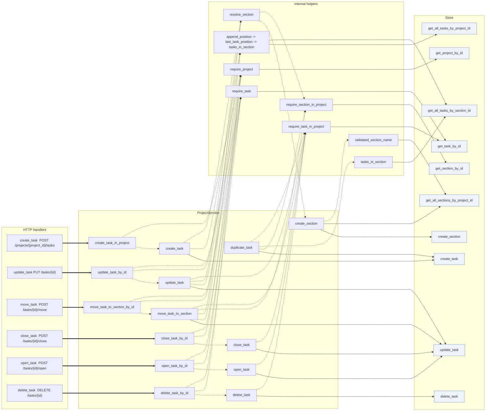
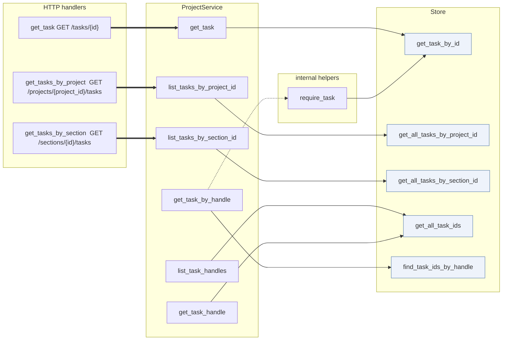
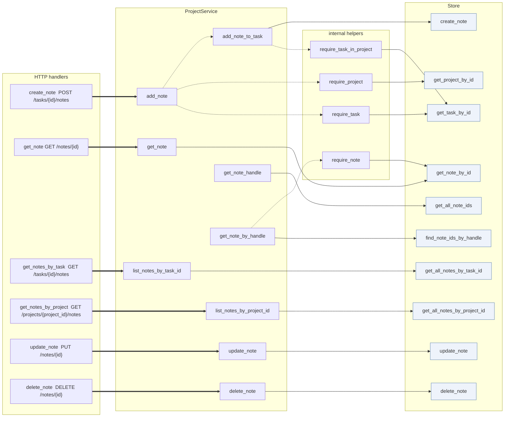
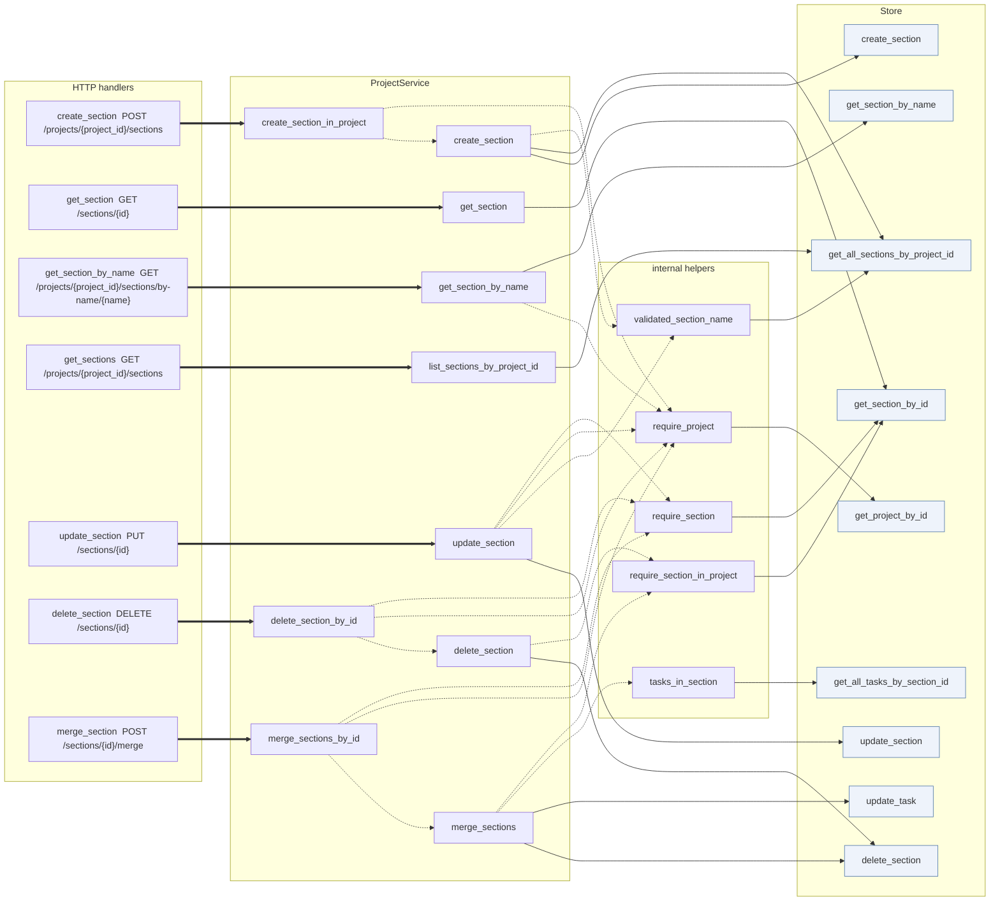
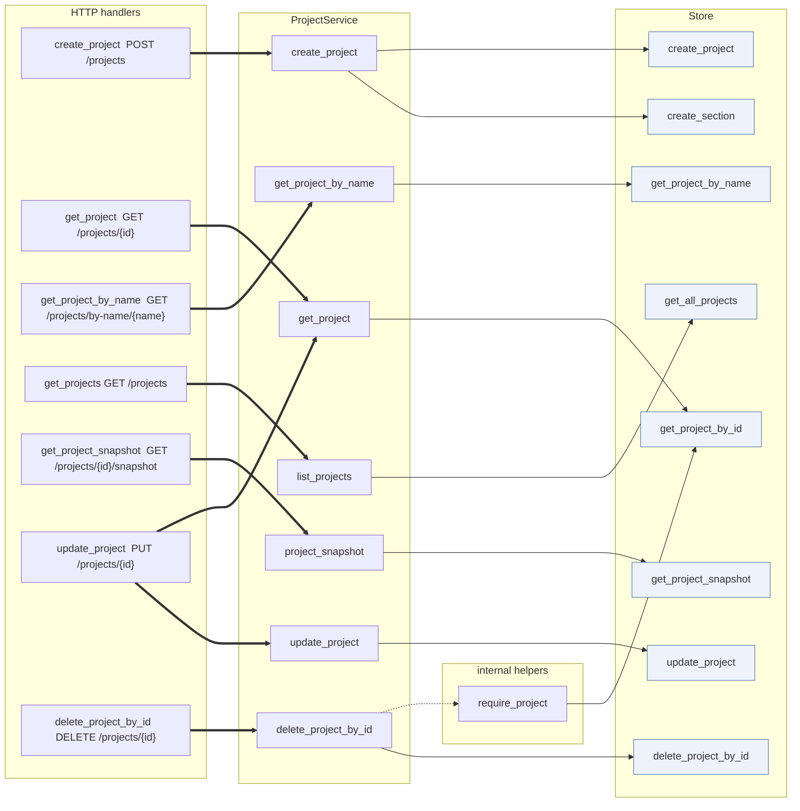
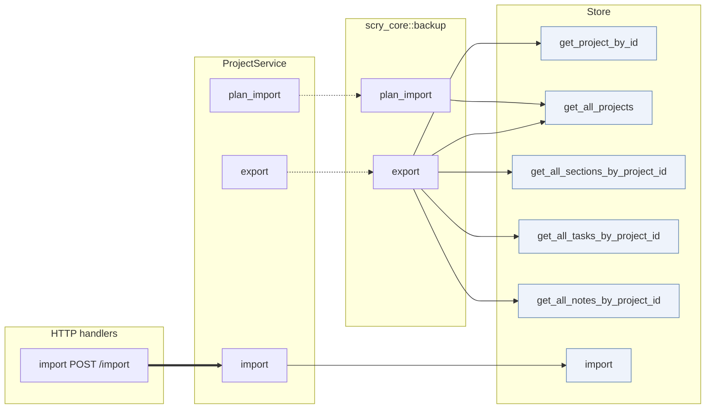

# Service / Store call graph

Derived from `src/service.rs` (`ProjectService`), `crates/scry-core/src/store.rs` (the `Store` trait), `crates/scry-core/src/backup.rs`, and the REST handlers in `src/server/handlers.rs`. `PostgresStore` is the only implementor of `Store`, and `ProjectService` is the only caller of `Store` apart from the backup module.

## How to read these diagrams

- Solid arrow (`-->`): a call across the boundary into the `Store` trait.
- Dashed arrow (`-.->`): an internal `ProjectService` call, including delegations into `scry_core::backup`.
- Thick arrow (`==>`): a REST handler calling into the service. The route is in the handler's label. CLI commands call the same service methods and are not drawn.
- A node label containing arrows, such as `append_position -> last_task_position -> tasks_in_section`, is a collapsed call chain drawn as one node so the diagram stays legible; its edges leave the collapsed node for the store calls made at the end of the chain. The arrow direction is written with the ASCII sequence `->`.
- `*_by_id` and `*_in_project` service methods are drawn only where a handler or another service method calls them.

## 1. Tasks - mutations

Creating, updating, moving, closing, opening, deleting, and duplicating tasks. Every mutation reads the task, changes fields, and writes the whole row back with one `Store::update_task`; `duplicate_task` copies the row through `Store::create_task`.

## 2. Tasks - reads and handles

Listing tasks by project or section, single-task lookup, and the handle machinery. Handles are computed at display time by the CLI, so they have no handler layer here; `get_task_by_handle` turns a typed prefix into a task.

## 3. Notes

Adding, listing, fetching, updating, and deleting notes. Notes have no handler for handle resolution; `get_note_handle` and `get_note_by_handle` exist for the CLI and for future note-prefix entry points.

## 4. Sections

Section creation, lookup, listing, updates, deletion, and merging. Name lookups are exact, and a miss fails with `SectionNotFound`, which is why the lookup reaches `require_project` to name the project in the error. Merge is service-level: it moves each source task with `Store::update_task` and then deletes the source, so it is not atomic.

## 5. Projects

Project creation, listing, lookup, snapshot, update, and deletion. The read methods are thin pass-throughs to `Store`. `create_project` is the only writer that also creates sections, and only when given a `ProjectSetup::Template`. The update handler reads the project before writing it because `update_project` needs the row it is patching.

## 6. Backup and import

`export` and `plan_import` delegate into `scry_core::backup`, which reads through `&dyn Store`; `import` applies a plan directly. Only `import` has a handler — export and plan creation are CLI-only, since the plan is produced by the client before it is posted.

## Coverage

- The six diagrams together touch all 30 `Store` trait methods (8 task, 8 note, 6 section, 7 project, 1 import) and every REST handler in `src/server/handlers.rs` except `index`, which only reports server metadata.
- `get_note_by_id`, `get_all_notes_by_task_id`, `update_note`, `delete_note` and `find_note_ids_by_handle` are marked `dead_code` on the trait and are reached only by the note scaffolding methods `get_note`, `list_notes_by_task_id`, `update_note`, `delete_note` and `get_note_by_handle`.

## Notes

- `export` and `plan_import` live in `scry_core::backup` and take `&dyn Store`, so the service reaches the store through them rather than calling it directly.
- Reads may use `Store` directly in principle, but in this codebase every store call goes through `ProjectService`.
